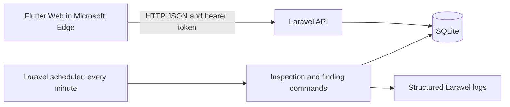

# Campus Facility Inspection Scheduler

**Project 33 · Week 13 SA7 · Automation Foundation**

| Student detail | Information |
| --- | --- |
| Name | Reehzie Nixandra Calinawan |
| Program and section | BSIT 3A |
| Course | PFEBSIT 002 — Integrative Programming and Technologies 2 |
| GitHub | [natsusawasaku123](https://github.com/natsusawasaku123) |
| Repository | [project33-campus-facility-inspection-scheduler](https://github.com/natsusawasaku123/project33-campus-facility-inspection-scheduler) |

## Project overview

The Campus Facility Inspection Scheduler is a Flutter Web and Laravel classroom prototype for planning recurring facility inspections and following up on failed checklist items. It uses fictional facilities and accounts, including **Demo Science Room**.

Supervisors create inspection plans, inspectors complete assigned checklists, and failed items can be recorded as findings through the API. A scheduler generates inspection tasks and processes overdue alerts. Maintenance users can view their alerts, while supervisors can view escalations, alerts requiring human review, and a compliance summary.

## Implemented features

| Feature | Current behavior |
| --- | --- |
| Facility browser | Loads facility names and IDs from Laravel, with loading, empty, error, and retry states. |
| Authentication | Laravel Sanctum bearer tokens expire after one hour. Protected endpoints check the user's role. |
| Inspection plans | Supervisors choose a facility, inspector, future first due time, and repeat interval of 1–365 days. |
| Recurring inspections | Generates due inspection occurrences and advances each plan's next due time. A unique plan/time pair prevents duplicate occurrences. |
| Inspector checklist | Assigned inspectors record Pass or Fail for exits/walkways, equipment safety, and cleanliness. Completed answers can be viewed again. |
| Findings API | Records a finding for a failed item on a completed inspection and assigns it to a maintenance user. |
| Finding alerts | Records an in-app overdue alert for maintenance and an escalation for the supervisor after the configured delay. |
| Failure handling | Supports controlled local transient failures, delayed retries, and routing to `manual_review`. |
| Supervisor overview | Shows delivered supervisor alerts, manual-review alerts, and the current compliance summary using `Asia/Manila`. |

## Architecture and repository layout



```text
project33-campus-facility-inspection-scheduler/
├── README.md
├── .gitignore
├── backend/
│   ├── app/Console/Commands/       # Recurrence and finding alert processors
│   ├── app/Http/Controllers/      # Inspection checklist and finding actions
│   ├── config/facility.php        # Demo password and escalation setting
│   ├── database/migrations/      # Database schema
│   ├── database/seeders/         # Facilities, accounts, local failure fixture
│   ├── routes/api.php            # API endpoints and role checks
│   ├── routes/console.php        # Scheduler definitions
│   └── tests/                    # Existing Laravel scaffold tests
└── frontend/
    ├── lib/                      # Flutter screens and API calls
    ├── test/widget_test.dart     # Facility rendering test with a mock API
    └── web/                      # Flutter Web entry files
```

The local `SA7_Evidence/` folder is ignored by Git. Keep the report, screenshots, and exported logs in the separate course submission folder in Google Drive.

## Requirements

- Windows with PowerShell, Android Studio with Flutter support, Microsoft Edge, and Git.
- Flutter with a Dart SDK satisfying `^3.13.7`, as declared in `frontend/pubspec.yaml`.
- PHP satisfying `^8.2`, Composer, and the PDO SQLite extension.
- Laravel and Sanctum are installed through Composer. The committed lockfile records Laravel **12.71.0** and Sanctum **4.3.3**.

Use `flutter --version`, `flutter doctor -v`, `flutter devices`, `php --version`, and `composer --version` to record your actual workstation versions. The application version in `pubspec.yaml` is `1.0.0+1`.

## Set up a fresh clone

If the application already runs in your existing `Project33` folder, continue with **Run the application**. These setup steps are for a new local copy.

```powershell
git clone https://github.com/natsusawasaku123/project33-campus-facility-inspection-scheduler.git
cd project33-campus-facility-inspection-scheduler
cd backend
composer install

if (-not (Test-Path .env)) {
    Copy-Item .env.example .env
}

if (-not (Test-Path database/database.sqlite)) {
    New-Item -ItemType File -Path database/database.sqlite | Out-Null
}

php artisan key:generate
```

Edit `backend/.env` locally:

- Keep `APP_ENV=local` and `DB_CONNECTION=sqlite`.
- Set `APP_URL=http://127.0.0.1:8000`.
- Set `FACILITY_DEMO_PASSWORD` to your own local password of **12–64 characters**. All four demo accounts use that selected password.
- Leave `DB_DATABASE` unset to use Laravel's default `database/database.sqlite` path, or set it to the absolute SQLite file path on your workstation.

Then, from `backend/`, run:

```powershell
php artisan config:clear
php artisan migrate
php artisan db:seed --class=FacilitySeeder
php artisan db:seed --class=DemoUserSeeder
```

Use these explicit seed commands: the default `DatabaseSeeder` creates a generic test user rather than the four role accounts. Running `DemoUserSeeder` again updates the demo accounts to the password currently configured in `.env`.

Keep the actual `.env`, SQLite database, tokens, and generated logs outside the repository. `.env.example` is the configuration template to share.

## Run the application

Open three terminal tabs. Start each tab in the repository root, which may be named `Project33` on your existing PC.

**Terminal 1 — Laravel API**

```powershell
cd backend
php artisan serve --host=127.0.0.1 --port=8000
```

Open <http://127.0.0.1:8000/api/health>; the expected response is `{"status":"ok"}`.

**Terminal 2 — Scheduler**

```powershell
cd backend
php artisan schedule:list
php artisan schedule:work
```

Keep this terminal running for recurring inspections, overdue alerts, and escalations to be processed automatically.

**Terminal 3 — Flutter Web in Microsoft Edge**

```powershell
cd frontend
flutter pub get
flutter run -d edge --web-port=5000 --dart-define=API_BASE_URL=http://127.0.0.1:8000/api
```

In Android Studio, open the `frontend` folder containing `pubspec.yaml` when working on Flutter. If Edge is not listed by `flutter devices`, use `-d web-server` instead of `-d edge` and open the printed URL manually in Edge.

To stop Flutter, press `q` in its terminal. Use `Ctrl+C` in the API and scheduler terminals when finished.

## Demo accounts and screen flow

| Email | Role | Available workflow |
| --- | --- | --- |
| `supervisor@example.test` | Supervisor | Facility list → New plan; Alerts & Compliance. |
| `inspector@example.test` | Inspector | My Inspections → assigned inspection → checklist. |
| `maintenance@example.test` | Maintenance | Finding Alerts. |
| `custodian@example.test` | Custodian | Seeded account; the current build has no dedicated custodian workflow. |

Use your locally configured `FACILITY_DEMO_PASSWORD` to sign in. Switch accounts through the app bar. Sign in again after a token expires.

1. Sign in as supervisor and create a plan for Demo Science Room, with a first due time a few minutes in the future and a repeat interval of at least one day.
2. Leave the scheduler running. After the due time, allow the next scheduler check to generate the inspection.
3. Switch to the assigned inspector, open **My Inspections**, and save all checklist answers. Include a failed item if demonstrating a finding.
4. Create the finding using `POST /api/inspections/{inspection}/findings` with the inspector's bearer token. Finding creation is currently an API action; there is no Flutter finding-entry form.
5. Once the finding becomes overdue, view **Finding Alerts** as maintenance. After the configured escalation delay, view the escalation as supervisor.
6. Open or refresh **Alerts & Compliance** as supervisor to calculate the current summary.

## API overview

All paths below start with `/api`. Protected calls use `Authorization: Bearer YOUR_LOCAL_TOKEN` and `Accept: application/json`. Send JSON request bodies with `Content-Type: application/json`.

| Method | Path | Access | Purpose |
| --- | --- | --- | --- |
| GET | `/health` | Public | API connectivity check. |
| GET | `/facilities` | Public | List facility IDs and names. |
| POST | `/auth/login` | Public; throttled | Accept `email` and `password`; return token and user details. |
| GET | `/user` | Authenticated | Read the signed-in user. |
| GET | `/inspectors` | Supervisor | List available inspectors. |
| POST | `/plans` | Supervisor | Create a recurring plan. |
| GET | `/inspections` | Inspector | List only the signed-in inspector's assigned inspections. |
| GET | `/inspections/{inspection}/checklist` | Assigned inspector | Load checklist items and saved results. |
| PUT | `/inspections/{inspection}/checklist` | Assigned inspector | Save all Pass/Fail results and complete the inspection. |
| POST | `/inspections/{inspection}/findings` | Assigned inspector | Record a finding for a failed item on a completed inspection. |
| GET | `/finding-alerts` | Maintenance or supervisor | Read the user's delivered alerts; supervisors also see manual-review alerts. |
| GET | `/compliance-summary` | Supervisor | Calculate the current Manila-date summary. |

Important request fields:

- **Plan:** `facility_id`, `inspector_id`, `first_due_at` as a future ISO 8601 timestamp, and `repeat_days` from 1 to 365.
- **Checklist:** `results` containing `exits_clear`, `equipment_safe`, and `room_clean`, each set to `pass` or `fail`.
- **Finding:** `checklist_key`, `description` up to 1,000 characters, `assigned_to_user_id` belonging to maintenance, and a future `due_at` timestamp. Use real IDs from your local demo database.

Successful reads return `200`; plan and finding creation return `201`. Relevant failure responses include `401` for missing/invalid authentication, `403` for a forbidden role, `404` for unavailable records, `409` for conflicting submissions, `422` for invalid inputs, and `429` for excessive login attempts. Run `php artisan route:list --path=api` from `backend/` for the registered routes.

## Automation, retry, and human review

| Process | Trigger and behavior |
| --- | --- |
| `inspections:process` | Every minute. Creates at most one due occurrence per plan per invocation and advances the next due time by `repeat_days`. Transactions and a unique plan/time constraint protect occurrences. |
| `findings:process` | Every minute. Processes open findings at or after their due time and records one alert per finding/kind. |
| Supervisor escalation | Eligible after `FACILITY_FINDING_ESCALATION_MINUTES`, which defaults to `1440` minutes (24 hours) after the deadline. |
| Compliance summary | Calculated when the supervisor requests it. Inspection counts use the current `Asia/Manila` day; open, overdue, escalated, and manual-review counts describe the current records. |

The two scheduled commands use `withoutOverlapping()`. The summary is currently generated on demand; a scheduled, stored daily summary is future work.

Transient demo failures retry after **60 seconds**, then **120 seconds**, for a maximum of **three total attempts**. The scheduler processes an eligible retry on a subsequent check. An unavailable recipient or an exhausted transient failure enters `manual_review`; later scheduled runs leave that alert in review. Delivery means an in-app database alert, with no email or SMS provider.

For a controlled transient experiment, use a new overdue finding assigned to maintenance whose overdue alert has not already been delivered. Stop the automatic scheduler during the experiment so it does not process the alert first. From `backend/`:

```powershell
# Replace 1 with the actual eligible finding ID.
$findingId = 1
php artisan findings:process --demo-finding=$findingId --demo-failures=1
```

After at least 60 seconds, run `php artisan findings:process` to allow recovery. To demonstrate exhausted retries, pass `--demo-failures=3` and the same `--demo-finding` on every attempt, observing the 60- and 120-second eligibility delays. Demo failure options require `APP_ENV=local`.

The optional `PermanentFindingFailureSeeder` creates a local fixture with an ineligible maintenance recipient. It requires an existing finding with ID `1` on a completed, inspector-assigned inspection; it does not seed a full workflow from an empty database:

```powershell
php artisan db:seed --class=PermanentFindingFailureSeeder
php artisan findings:process
```

Restart `php artisan schedule:work` after the experiment. Inspect `backend/storage/logs/laravel.log` for `inspection.generated`, `inspection.cycle_finished`, `finding.alert_attempt`, and `finding.automation_cycle_finished`. Alert entries contain the run ID, finding ID, alert ID, kind, attempt, status, recipient ID, error code, and next retry time.

## Verification and Week 13 evidence

Run these checks on the version you will submit. These commands are verification instructions, not a claim that all checks have passed.

From `backend/`:

```powershell
php artisan test
php artisan route:list --path=api
php artisan schedule:list
```

From `frontend/`:

```powershell
flutter analyze
flutter test
flutter build web --dart-define=API_BASE_URL=http://127.0.0.1:8000/api
```

The committed Flutter test checks facility rendering with a mock API. The Laravel tests are scaffold examples. Automated coverage for authentication, plans, checklists, findings, retries, and escalation is still to be added; document the corresponding manual checks and actual results in the SA7 report.

Collect screenshots and logs for API/Flutter connectivity, validation and authorization, recurring generation without duplicates, checklist completion, maintenance alerts, supervisor escalation and summary, transient recovery, and permanent failure routed to review. Record the tested commit (`git rev-parse HEAD`), date, workstation versions, expected results, and actual results in the evidence index. Keep passwords, tokens, and `.env` contents out of screenshots.

## Maintenance and troubleshooting

| Change or issue | Where to look |
| --- | --- |
| API connection fails | Confirm the Laravel terminal is running and `/api/health` works. Check `API_BASE_URL` and the browser console. If a local CORS configuration restricts origins, allow the exact Flutter origin and required headers/methods. |
| Demo account seeding fails | Check `FACILITY_DEMO_PASSWORD` length, `APP_ENV=local`, and run `php artisan config:clear` before seeding. |
| No recurring task or alert appears | Check the due time, record status, and running scheduler. Run `schedule:list` and inspect the logs. |
| Change scheduler frequency | `backend/routes/console.php`. |
| Change escalation delay | `backend/config/facility.php` or local `FACILITY_FINDING_ESCALATION_MINUTES`; clear cached configuration afterward. |
| Change retry delays or limit | `backend/app/Console/Commands/ProcessFindingAlerts.php`. |
| Change checklist items | `backend/app/Http/Controllers/InspectionChecklistController.php`; update affected frontend behavior and evidence. |

## Current scope and next improvements

This version demonstrates the inspection-to-alert workflow through Flutter screens, API actions, scheduler commands, and local failure fixtures. Maintenance correction entry, supervisor verification/closure, a recorded manual-review resolution action, a Flutter finding-entry form, and persisted daily summary generation remain to be implemented. Manual-review alerts currently provide a supervisor handoff message for investigation.

## Acknowledgments

- Built with [Flutter](https://docs.flutter.dev/), the Dart `http` package, [Laravel 12](https://laravel.com/docs/12.x), Laravel Sanctum, and SQLite.
- ChatGPT/Codex assisted with development guidance and README preparation.
